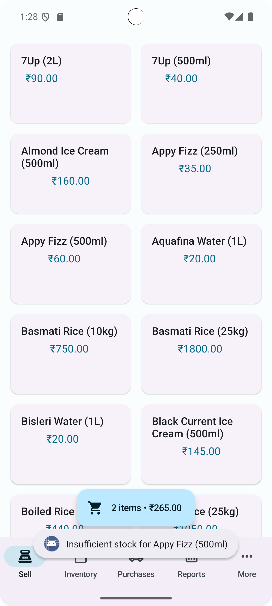

# RetailPilot

[](https://github.com/chinmaygit-lab/retailpilot/actions/workflows/android-ci.yml)
[](https://github.com/chinmaygit-lab/retailpilot/releases)
[](LICENSE)

**Offline-first Android point of sale and inventory management for small retail businesses.**

RetailPilot combines checkout, purchasing, stock-batch tracking, supplier management,
analytics, barcode/OCR-assisted workflows, reminders, invoices, and local persistence in a
modular Kotlin application. Core retail workflows remain usable without a network connection.

<p align="center">
  
</p>

## Try RetailPilot

The easiest way to evaluate the project is from the latest GitHub Release:

**Releases:** https://github.com/chinmaygit-lab/retailpilot/releases

Each v1.x GitHub release is intended to publish a CI-built **demo APK** plus a SHA-256 checksum.
The demo APK is debug-signed and is for portfolio/testing use, not Play Store distribution.

For development builds:

```powershell
.\gradlew.bat clean assembleDebug
```

The APK is produced under:

```text
app/build/outputs/apk/debug/
```

## What it does

- Product catalogue and inventory management
- Cart-based sales and checkout
- Purchase and supplier workflows
- Stock batches and inventory movements
- Insufficient-stock validation
- Payment tracking
- Sales and business analytics
- Low-stock reminders with WorkManager
- Barcode-assisted product workflows
- ML Kit text recognition
- PDF invoice generation and receipt sharing
- Business profile management
- Adaptive layouts for different screen sizes
- Offline-first Room database
- Versioned database migrations

## Why the architecture matters

RetailPilot is organized by application responsibility instead of keeping the whole app in one
Android module:

```text
RetailPilot
├── app
│   ├── application entry point
│   ├── navigation
│   ├── ViewModels
│   └── background workers
├── core
│   ├── Room database
│   ├── entities
│   ├── DAOs
│   ├── repository layer
│   ├── dependency injection
│   └── shared utilities
├── feature:store
│   ├── sales
│   ├── inventory
│   ├── purchases
│   ├── checkout
│   └── adaptive retail UI
└── feature:reports
    └── analytics and reporting
```

## Data integrity

RetailPilot models real retail operations with entities such as `Product`, `Sale`, `SaleLine`,
`Purchase`, `PurchaseLine`, `Payment`, `Supplier`, `StockBatch`, `StockMovement`,
`StockReminder`, and `ProductPriceHistory`.

Money is stored in integer minor units rather than floating-point values.

Room schema history is retained under:

```text
core/schemas/com.salespro.data.AppDatabase/
```

Migration tests live under:

```text
core/src/androidTest/java/com/salespro/data/
```

Resolved migration and inventory-model decisions are documented in
[`docs/debugging-history.md`](docs/debugging-history.md).

## Technology

- Kotlin
- Jetpack Compose
- Material 3
- Room
- Hilt
- WorkManager
- ML Kit
- AndroidX
- Coroutines / Flow
- Gradle Kotlin DSL

Current Android configuration:

- minimum SDK: 26
- target SDK: 36
- compile SDK: 36
- Java/Kotlin JVM target: 17

## Verification

The release gate is:

```powershell
.\gradlew.bat clean assembleDebug
.\gradlew.bat testDebugUnitTest
.\gradlew.bat lintDebug
```

GitHub Actions runs the same build/test/lint checks on pushes and pull requests to `main` and
uploads the generated debug APK as a workflow artifact.

A GitHub Release triggers a second workflow that rebuilds the project, verifies that the APK's
`versionName` matches the release tag, computes SHA-256, and attaches the demo APK and checksum
to the release.

## Build locally

1. Install Android Studio / Android SDK.
2. Clone this repository.
3. Create `local.properties` (never commit it):

```properties
sdk.dir=C\:\\path\\to\\Android\\Sdk
```

4. Run:

```powershell
.\gradlew.bat assembleDebug
```

## Versioning

The first productized GitHub release is intended to use:

```text
versionCode = 1
versionName = "1.0.0"
Git tag     = v1.0.0
```

For future Android releases:

- increment `versionCode` for every APK/AAB release;
- update `versionName` to the public release version;
- make the Git tag `v<versionName>`;
- require green CI before publishing the GitHub Release.

The release workflow rejects a tag whose version does not match the built APK.

## Release signing

Release credentials are intentionally not stored in Git.

The Gradle release configuration can read:

```text
RELEASE_KEYSTORE_PATH
RELEASE_STORE_PASSWORD
RELEASE_KEY_ALIAS
RELEASE_KEY_PASSWORD
```

The automated GitHub portfolio release currently attaches a **debug-signed demo APK** so no
private signing key is required in GitHub. A Play Store/release-signed pipeline should be added
only after a production keystore and secret-management plan are intentionally configured.

## Security

Do not commit:

- keystores
- signing passwords
- `local.properties`
- `google-services.json`
- private service credentials

See [`SECURITY.md`](SECURITY.md).

## Contributing

See [`CONTRIBUTING.md`](CONTRIBUTING.md).

## License

Apache-2.0. See [`LICENSE`](LICENSE).

## Status

RetailPilot is a portfolio-grade Android application with validated debug builds, unit tests,
Android lint, database migrations, and CI. The v1.0 productization work adds reproducible
GitHub release artifacts so reviewers can inspect and install a concrete build rather than only
reading source code.
